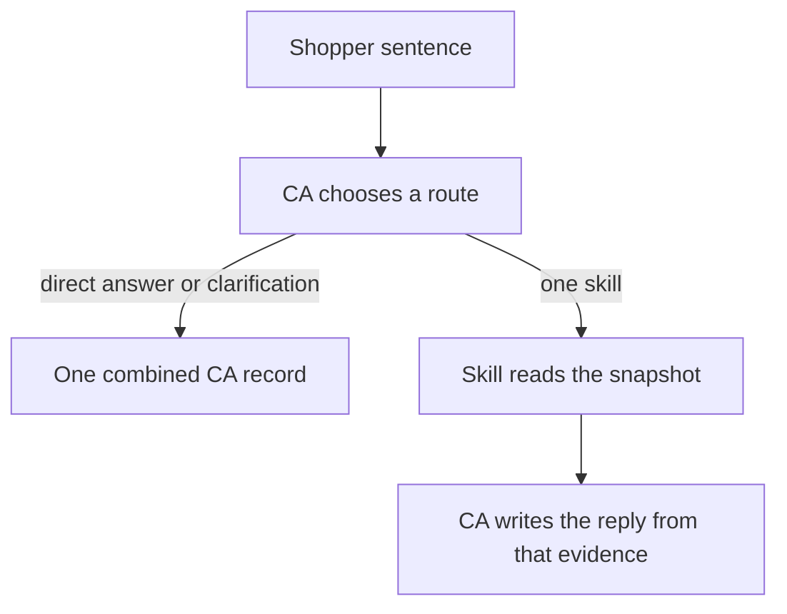
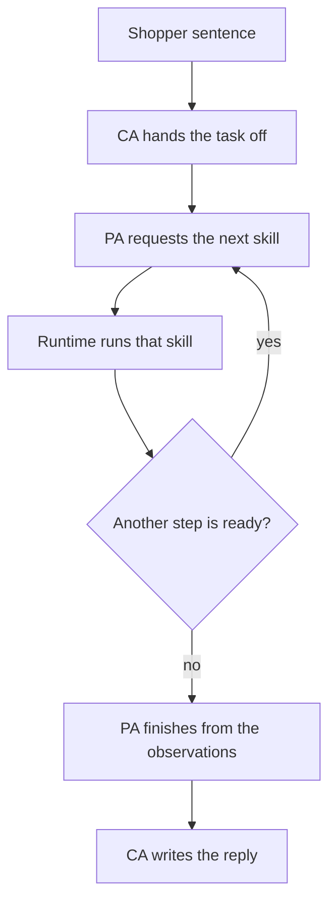

# Shopping assistant lab

Offline lab for a shopping **communication agent (CA)** and a **planner agent (PA)**. The CA decides whether to answer, ask a clarifying question, call one skill, hand a multi-step task to the planner, or escalate to a person. The PA keeps a per-task plan with dependencies and requests the next skill. A separate evidence gate checks the reply. Session memory outlives a single task. A task's working state does not.

The default path is a deterministic mock. It does not use the network, a credential, or a GPU. A configured chat-completions endpoint is optional and explicit. The automated tests use a local stub, not a paid or live model. The public page never calls an endpoint. The local server calls one only after you opt in.

Session context is a stable profile, notes from the last seven days, and the current session. The session bundle is the latest 10 messages, a summary through a watermark, and structured state. Details are in `docs/memory.md`. Evaluation uses three suites (development, regression, online sample). Those suites are separate from capability tags and from the train/val/test split; see `docs/evaluation.md`. Loop limits, model timeouts, and the 200 ms progress delay live in one settings file; see `docs/configuration.md`.

This repository is a demonstration. The curated corpus is not enough to train a production model, and the passing mock report is not a measured gain from a trained model.

## Status

| Area | State |
| --- | --- |
| Versioned CA/PA examples, synthetic catalog, synthetic knowledge base | Implemented |
| Local MCP tool server and client (framed JSON-RPC over stdio) | Implemented and covered by transport tests |
| Skills for search, quote, compare, policy lookup, and constraint checks | Implemented; the runtime calls them through MCP |
| Resettable per-session tool process, fault injection, replay log | Implemented |
| Mock multi-turn regression with outcome checks | Implemented and run in this lab |
| Supervised-tuning dry-run | Implemented; does not run an optimizer |
| Tiny generated-model CPU smoke | Implemented; a few momentum steps, save, and reload for CA and PA separately |
| Larger-model and GPU training | Config only; not run and not verified |
| Preference or reward training | Roadmap only; calling it raises `NotImplementedError` |
| Optional local judge | Rubric only; score stays null and is not a pass |
| Configured model endpoint | Adapter and config schema exist; no live call was made |
| Local chat UI | Mock by default. Configured mode calls the opted-in CA and PA endpoints and still uses skills and the tool server |

## Flow

A shopper sentence is one turn. Two kinds of work happen on that turn, and they are not the same thing.

- A **model invocation** is a decision by the communication agent or the planner. On the public page these decisions are simulated and labeled. On a configured local server they are HTTP calls to the endpoint you opted in.
- A **tool call** is a skill reading the synthetic catalog, a policy note, or a shipment snapshot. The tool returns evidence. It is not a model invocation, and it is not counted in the call totals below.

The communication agent does not invent a price, a stock count, or a policy number. The shopper-facing sentence is rendered from tool evidence and then checked by the evidence gate. Neither agent has a hidden reasoning field in the trace.

### Communication agent

The communication agent reads the sentence and chooses one route:

1. Answer directly. A capability question and a short thanks take this route. No tool runs, and the planner does not start.
2. Ask for a missing detail, or say that this demo does not support the sentence. No tool runs, and the planner does not start.
3. Call one skill. A price or stock quote, a return window, a shipment lookup, and a knowledge lookup take this route.
4. Hand a multi-step shopping task to the planner.
5. Escalate to a person when the shopper asks for one, or when tool evidence conflicts.

Routes 1, 2, and 5 are communication-agent only. Route 3 is still communication-agent only: one skill runs, and the planner is not called. Route 4 is the only path that starts the planner.

### Planner agent

The planner runs only after a handoff. It keeps a short plan. A later step can depend on an earlier observation. Each planner invocation does one of these:

1. Build the plan and request the first ready skill.
2. After that skill returns, request the next ready skill. This happens only when the plan still has a step waiting on the observation.
3. When no step is waiting, finish from the observations.

The runtime then executes the requested skill. The skill's result is an observation for the next planner invocation. The communication agent writes the shopper-facing sentence after the planner finishes.

### Communication agent only



A direct answer or a clarification is one recorded communication-agent call. The sentence is included in that same record. There is no second call just to render it.

A one-skill turn is two recorded communication-agent calls. The first requests the skill. The tool runs. The second writes the reply from the tool result. That second record is the evidence renderer. On the public page it is labeled as a simulated communication-agent step. It is not a second network request, and the tool between the two records is not a model call.

### Communication agent and planner



The communication agent is recorded twice: the handoff, and the final reply. The planner count is the number of times it actually decides. A skill that runs between those decisions is not another model invocation. Some of those skills call a snapshot tool. The budget check does not: it only filters items the search already returned.

### Four example classes

These counts are for the example question on the matching scenario card. A later sentence in the same conversation can take a different route. Each card also has a Chinese example. That example takes the same route and the same counts. The public page records every one of these calls as simulated, inside the browser, with zero network model calls.

| Class | Example question | What the example actually does | CA | PA |
| --- | --- | --- | --- | --- |
| CA only, one call | What can you help with? | One combined route and answer. No tool and no planner. | 1 | 0 |
| CA only, two calls | How much is this item? | CA requests a quote. The snapshot tool returns the price and stock. CA writes the reply from that quote. | 2 | 0 |
| CA plus PA, PA twice | browse drinkware under 20 | CA hands off. PA plans and requests one search. PA then finishes from that search. CA writes the reply. The extra budget check does not run. | 2 | 2 |
| CA plus PA, PA more than twice | find drinkware under 20 | CA hands off. PA plans and requests a search. The search tool runs. PA then requests the budget check, which filters those items and calls no tool. PA then finishes. CA writes the reply. | 2 | 3 |

The stock, return-window, known-shipment, missing-shipment, and membership-note cards are the same two-call communication-agent class as the price question. Comparing the Matte ceramic mug 350 ml with the Blue stoneware mug 350 ml is the more-than-twice planner class with a longer plan: PA 4 and CA 2, six recorded calls in total. Those four planner calls are the plan plus the first quote, the second quote, the compare, and the finish.

### Public demo and a local endpoint

The public page always uses the mock decisions above. It does not call a chat-completions model, and it has no field for an API key. The pauses while a reply appears are presentation timing, not model latency.

A local server can call a real endpoint only after you set `SHOPASSIST_MODE=configured_endpoint` and `SHOPASSIST_OPT_IN_CONFIGURED_MODEL=yes`, and you provide a base URL and model name for each agent. That mode does not add the simulated records.

1. The communication agent is one HTTP request. Its JSON chooses the route. For a direct answer or a clarification, that same response includes the reply text.
2. A simple skill or a handoff still renders the price, stock, and policy sentences from tool evidence. The model does not supply those numbers.
3. The planner is one HTTP request for each decision it returns. How many times it is called depends on the decisions it returns. It is not fixed to the counts in the table above.
4. Accepted planner goals are `search`, `recommend`, `compare`, and `oos`. The one-search browse plan is a mock-only demo path.
5. A missing opt-in, a missing endpoint or model, HTTP 401, or invalid JSON fails the turn. The server does not silently switch back to the mock. HTTP 429 and 503 can be retried inside `loop.max_retries_per_step`.

Automated tests use a local stub. Compatibility with a live provider account was not verified.

The regression harness is separate from these shopper turns. Scenario cards drive a user simulator, the simulator does not read plans or tool payloads, and the scorer writes a local report. The training dry-run reads exported examples. It does not run this turn loop.

## Quickstart

Python 3.11+ is enough. No third-party packages are required.

```bash
python -m shopassist.cli quickstart
python -m unittest discover -s tests -v
python -m shopassist.web.server --host 127.0.0.1 --port 8765
```

`quickstart` rebuilds the demonstration corpus, runs the mock evaluation, and dry-runs both smoke training configs. It writes `reports/quickstart.json` and `reports/quickstart.md`. Reports are local artifacts and are not the trained-model result.

Other commands:

```bash
python -m shopassist.cli build-corpus --output data/demo_corpus
python -m shopassist.cli eval --mode mock --output reports/mock_eval.json
python -m shopassist.cli eval-catalog --suite development --tag memory --output reports/dev_memory.json
python -m shopassist.cli eval-catalog --suite regression --output reports/eval_catalog.json
python -m shopassist.cli eval-import-online --input data/eval/online_samples.example.json --output reports/online_batch.json
python -m shopassist.cli compare --baseline baselines/mock_demo_v1.json --candidate reports/mock_eval.json --gates configs/gates_demo.json --output reports/compare.json
python -m shopassist.cli train --config configs/sft_ca_smoke.json
python -m shopassist.cli train --config configs/sft_pa_smoke.json
python -m shopassist.cli train --config configs/sft_ca_smoke.json --execute
python -m shopassist.cli train --config configs/sft_ca_local_random.json --execute
python -m shopassist.cli train --config configs/sft_pa_local_random.json --execute
python -m shopassist.cli check-config
# effective settings are printed with secrets redacted; defaults are config/shopassist.example.json
python -m shopassist.cli bench --component catalog
```

`--execute` on `configs/sft_*_smoke.json` returns a non-success status when that model directory is absent. It does not fall back to the mock and then report a successful training run. `configs/sft_*_local_random.json` is a separate CPU smoke: it builds a generated tiny model, runs two momentum-SGD steps, and reloads the adapter. That smoke is not a quality result. The larger configs under `configs/sft_*_larger.json` raise the rank and the step count; those files were not executed, and no GPU training was verified.

A missing baseline is a blocked compare, not a pass. An unavailable judge stays null. Gates live in `configs/gates_demo.json` and are marked `demonstration_not_production`.

## Layout

| Path | Role |
| --- | --- |
| `shopassist/catalog.py` | Replaceable product snapshot: ids, static attributes, dynamic price, currency, stock |
| `shopassist/knowledge.py` | Replaceable policy documents with ids, freshness, and provenance |
| `shopassist/mcp/` | MCP server and client |
| `shopassist/skills/` | Versioned skill contracts |
| `shopassist/sandbox.py` | Per-session tool process and workspace |
| `shopassist/session_runner.py` | Multi-turn CA/PA runtime |
| `shopassist/cards.py` | Scenario gallery and outcome checks |
| `shopassist/corpus.py` | Train, validation, test, and held-out regression export |
| `shopassist/training.py` | SFT entrypoints |
| `shopassist/eval/` | Reports, gates, judge hook |
| `shopassist/web/` | Local chat UI |
| `docs/` | Architecture, contracts, data, scenarios, evaluation, sandbox |

## Schemas

CA examples use `ca.v1`. PA examples use `pa.v1`. A turn separates confirmed constraints, assumptions, and missing fields. Targets contain the route or plan, tool or skill calls, claims, limitations, and recovery. They do not contain a hidden reasoning field.

User text is rendered by `shopassist/simulator.py` from scenario slots. That module does not read plans or tool payloads. Tool facts are filled by the catalog and knowledge snapshots through MCP.

The held-out regression split is excluded from the training export. Splits are grouped by session id and by template lineage so one family does not land in two splits. See `docs/data.md`.

## Optional endpoint configuration

Copy `config/model_mode.example.json` to `config/local_model.json` if you want a local file. That destination is gitignored. Leave values blank to stay on the mock.

Environment variables, all optional:

| Variable | Purpose |
| --- | --- |
| `SHOPASSIST_MODE` | `mock` (default), `configured_endpoint`, or `local_weights` |
| `SHOPASSIST_OPT_IN_CONFIGURED_MODEL` | Must be `yes` before a configured endpoint is eligible |
| `SHOPASSIST_CA_BASE_URL` | CA chat-completions base URL |
| `SHOPASSIST_CA_MODEL` | CA model name |
| `SHOPASSIST_CA_API_KEY` | CA credential, if the endpoint requires one |
| `SHOPASSIST_PA_BASE_URL` | PA base URL |
| `SHOPASSIST_PA_MODEL` | PA model name |
| `SHOPASSIST_PA_API_KEY` | PA credential, if the endpoint requires one |

The lab never ships a real credential. Local URLs may omit a credential. Non-local URLs must use the environment variable named above, not a credential embedded in the URL. Errors report missing variable names and whether a credential is present. They do not echo the value.

The protocol is OpenAI-compatible `POST {base_url}/chat/completions` with `{"model","messages","temperature":0}`. The communication agent must return one JSON object: a route, and for a simple skill the skill id and arguments, or for a planner handoff a `goal_type` and `query`. Accepted planner goals remain `search`, `recommend`, `compare`, and `oos`. The public demo's one-search browse plan is mock-only and is not a configured-model goal. The planner agent returns the next action (`plan`, `tool_call`, `finish`, and the recovery actions). Configured mode records the endpoint calls and does not add simulated lifecycle events. Tools stay on the allowlisted synthetic catalog, policies, and shipments. The visible price, stock, and policy sentences are rendered from tool evidence and then checked by the evidence gate. The model does not get to invent those numbers. A missing opt-in, a missing endpoint or model, HTTP 401, or invalid JSON fails the request. The server does not answer with the mock policy. HTTP 429 and 503 can be retried inside `loop.max_retries_per_step`. This lab's automated tests use a local stub only. Compatibility with a live provider account was not verified.

Example, with the key only in the environment of the machine that runs the server:

```bash
export SHOPASSIST_MODE=configured_endpoint
export SHOPASSIST_OPT_IN_CONFIGURED_MODEL=yes
export SHOPASSIST_CA_BASE_URL=https://example.invalid/v1
export SHOPASSIST_CA_MODEL=your-ca-model
export SHOPASSIST_CA_API_KEY=your-local-key
export SHOPASSIST_PA_BASE_URL=https://example.invalid/v1
export SHOPASSIST_PA_MODEL=your-pa-model
export SHOPASSIST_PA_API_KEY=your-local-key
python -m shopassist.cli check-config
python -m shopassist.web.server --host 127.0.0.1 --port 8765
```

`check-config` prints whether a credential is present. It does not print the credential. GitHub Pages does not read these variables and has no key field.

Configured chat, after the variables above are set and the opt-in is `yes`:

```bash
python -m shopassist.web.server --host 127.0.0.1 --port 8765
```

Open the page and choose **Configured model**. The server calls the CA endpoint, and the PA endpoint only after a complex handoff. Tool calls still go through skills and the local MCP server. The browser receives the mode name and whether a credential is present. It does not receive the credential, and the page does not store one. If the opt-in or a required setting is missing, the request fails and the server does not answer with the mock policy. Leaving the selector on **Mock demo** does not call an endpoint.

## GitHub Pages demo

`python -m shopassist.pages.build --output site --base /ShoppingAssistant/` writes a static site. GitHub Pages cannot run the Python server, MySQL, or Redis. The page loads a pinned Pyodide build from the site itself and runs the mock session in the browser. Tool calls use the in-process gateway on the synthetic snapshots. The prebuilt knowledge index uses the hashing lexical baseline. The page does not download an embedding model and does not call MCP or a vector database.

The shop name on the page is Demo Flagship Store. The Chinese view uses the Chinese store name from the page configuration. English is the default. The first screen is a consultation for the catalog item Canvas court shoes (`prod-shoes-court`, 48 USD, stock 16). Product photos are original files shipped with the page. The layout is a conversation on the left and the execution trace on the right. Bot messages stay on the left of the conversation and shopper messages stay on the right. Nothing is sent automatically. Supported scenarios opens a list; each scenario has one Enter button, which starts a fresh conversation on that scenario's product and does not send a question. The trace panel shows the route, skills, tools, and evidence gate recorded for the turns in the current conversation.

This page runs the mock communication agent, planner, skills, and evidence gate inside the browser. It does not call a chat-completions model.

Catalog, policy, and shipment tools run in-process on the synthetic snapshots. There is no MCP child process and no network call to a store or carrier.

Session memory uses in-memory SQLite and an in-memory cache. MySQL and Redis are not used. Entering a scenario clears them.

The separate local Python server can use a configured model endpoint. This page never contacts that server and has no place to enter an API key.

The page uses the built-in default settings. It ignores SHOPASSIST environment variables and the local settings file. The local server still applies those.

The page sends the sentence shown on each shortcut. Chinese questions about this item's price are parsed directly. Catalog category ids such as drinkware stay in English.

Nothing here places an order or takes payment. Shipment answers describe the synthetic snapshot only.

Knowledge search on this page uses the prebuilt hashing lexical baseline shipped with the static files. It is not a semantic embedding and it is not a live vector database or MCP process.

The page records a simulated communication-agent and planner lifecycle around the real tool calls, then reveals the validated reply in short steps. Those calls do not leave the browser, and the pauses are not model latency.

The counts on a scenario card are for that card's example question. A later message can take a different route.

Each scenario opens on one product card, the first product for that scenario. A question the demo cannot parse gets a fixed limitation sentence in the selected language. It is not treated as a missing product or a failed tool.

Publish it from the `pages` workflow after the repository owner sets GitHub Pages to deploy from GitHub Actions. Until that setting exists, the workflow can build the artifact but the public URL is not live. The project URL, once Pages is enabled and a deployment succeeds, is `https://hongleiyu.github.io/ShoppingAssistant/`. This file does not claim that deployment has happened.

## Knowledge retrieval

The lab's original knowledge lookup is literal. `KnowledgeBase.search` checks whether the query string occurs in a topic, title, or body. `kb.get_policy` loads one topic from the tiny fixture documents. `training._embed` is a hash used by the tiny optimizer smoke, not a retrieval index. There was no chunker, no persisted vector index, and no semantic embedding.

`python -m shopassist.cli build-knowledge` writes 50 fictional policy articles and 1000 fictional products. Defaults are `knowledge.policy_count` 50, `knowledge.product_count` 1000, and `knowledge.seed` 0. Policy ids are `syn-pol-001` through `syn-pol-050`. Product ids are `syn-p-0001` through `syn-p-1000`. They do not replace `prod-*` or `kb-*` fixtures, and they are not training rows.

`python -m shopassist.cli build-index` embeds those chunks and writes `data/kb_index`. The default encoder is `hashing_lexical_baseline` (`char-word-hash-hash-v1`, 128 dimensions). Its score is a hashing cosine after a lexical token check. It is not a trained semantic embedding. `sentence_transformers` is optional: set `knowledge.encoder` and `knowledge.embedding_model` together. If the package or model is missing, the build fails and does not switch back to hashing. That semantic path was not executed in this lab because `sentence-transformers` is not installed.

`python -m shopassist.cli retrieve --query "membership points" --corpus policy` reads the index. A query whose tokens are absent returns `empty` / `no_match`. A dimension, model id, or encoder version that does not match the manifest raises `index_mismatch` and does not compare the vectors. Rebuilding the same corpus replaces the directory, so deleted ids do not linger.

`kb policy:` and `kb product:` run the `knowledge_retrieve` skill through MCP on the local server, or in-process on the static page. Policy facts come from chunk metadata. The body is untrusted and is not copied into the reply. Product hits are quoted on the fictional catalog before a price or stock is stated, and a confirmed budget still filters them. Details are in `docs/knowledge.md`.

## Chat UI

Open `http://127.0.0.1:8765` after starting the server. Scenario buttons run the same card harness as the regression scorer. Free text uses the mock session. The page shows the reply, products, skill events, and tool status. Document text is labeled as untrusted data. The page does not use browser storage, and the server binds to loopback unless you choose another host. Do not expose it publicly.

## Hardware and dependencies

- Default: CPython 3.11 or newer, CPU, no extra packages, no network.
- Optional training libraries are listed in `requirements-train.txt`. They are not installed by the default commands.
- A real optimizer run also needs a local model directory such as `local/models/tiny-generic`. That directory is not included.
- No container or cgroup limit is applied. See `docs/sandbox.md` for the threat model. This process boundary is not a secure sandbox for arbitrary code.

## Suggested repository description

Offline lab for a shopping communication agent and planner, with synthetic catalog and knowledge data, a local tool protocol, skills, and a small chat UI.

## License

No license file is added here.
