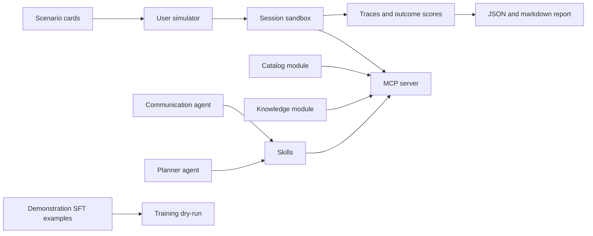

# Shopping assistant lab

Offline lab for a shopping **communication agent (CA)** and a **planner agent (PA)**. The CA decides whether to answer, ask a clarifying question, call a simple skill, hand off a complex task, or escalate to a person. The PA keeps a per-task plan with dependencies, calls skills, and checks evidence. Session memory outlives a single task. A task's working state does not.

The default path is a deterministic mock. It does not use the network, a credential, or a GPU. A configured chat-completions endpoint is optional, explicit, and is not called by the tests or the local chat UI.

Session context is a stable profile, notes from the last seven days, and the current session. The session bundle is the latest 10 messages, a summary through a watermark, and structured state. Details are in `docs/memory.md`. Evaluation uses three suites (development, regression, online sample). Those suites are separate from capability tags and from the train/val/test split; see `docs/evaluation.md`. Loop limits, model timeouts, and the 200 ms progress delay live in one settings file; see `docs/configuration.md`.

This repository is a demonstration. The curated corpus is not enough to train a production model, and the passing mock report is not a measured gain from a trained model.

## Status

| Area | State |
| --- | --- |
| Versioned CA/PA examples, synthetic catalog, synthetic knowledge base | Implemented |
| Local MCP tool server and client (framed JSON-RPC over stdio) | Implemented and covered by transport tests |
| Skills for search, quote, compare, policy lookup, and constraint checks | Implemented; the runtime calls them through MCP |
| Resettable per-session tool process, fault injection, replay log | Implemented |
| Mock multi-turn regression with outcome checks | Implemented and run in this lab |
| Supervised-tuning dry-run | Implemented; does not run an optimizer |
| Tiny generated-model CPU smoke | Implemented; a few momentum steps, save, and reload for CA and PA separately |
| Larger-model and GPU training | Config only; not run and not verified |
| Preference or reward training | Roadmap only; calling it raises `NotImplementedError` |
| Optional local judge | Rubric only; score stays null and is not a pass |
| Configured model endpoint | Adapter and config schema exist; no live call was made |
| Local chat UI | Mock by default. Configured mode calls the opted-in CA and PA endpoints and still uses skills and the tool server |

## Flow



## Quickstart

Python 3.11+ is enough. No third-party packages are required.

```bash
python -m shopassist.cli quickstart
python -m unittest discover -s tests -v
python -m shopassist.web.server --host 127.0.0.1 --port 8765
```

`quickstart` rebuilds the demonstration corpus, runs the mock evaluation, and dry-runs both smoke training configs. It writes `reports/quickstart.json` and `reports/quickstart.md`. Reports are local artifacts and are not the trained-model result.

Other commands:

```bash
python -m shopassist.cli build-corpus --output data/demo_corpus
python -m shopassist.cli eval --mode mock --output reports/mock_eval.json
python -m shopassist.cli eval-catalog --suite development --tag memory --output reports/dev_memory.json
python -m shopassist.cli eval-catalog --suite regression --output reports/eval_catalog.json
python -m shopassist.cli eval-import-online --input data/eval/online_samples.example.json --output reports/online_batch.json
python -m shopassist.cli compare --baseline baselines/mock_demo_v1.json --candidate reports/mock_eval.json --gates configs/gates_demo.json --output reports/compare.json
python -m shopassist.cli train --config configs/sft_ca_smoke.json
python -m shopassist.cli train --config configs/sft_pa_smoke.json
python -m shopassist.cli train --config configs/sft_ca_smoke.json --execute
python -m shopassist.cli train --config configs/sft_ca_local_random.json --execute
python -m shopassist.cli train --config configs/sft_pa_local_random.json --execute
python -m shopassist.cli check-config
# effective settings are printed with secrets redacted; defaults are config/shopassist.example.json
python -m shopassist.cli bench --component catalog
```

`--execute` on `configs/sft_*_smoke.json` returns a non-success status when that model directory is absent. It does not fall back to the mock and then report a successful training run. `configs/sft_*_local_random.json` is a separate CPU smoke: it builds a generated tiny model, runs two momentum-SGD steps, and reloads the adapter. That smoke is not a quality result. The larger configs under `configs/sft_*_larger.json` raise the rank and the step count; those files were not executed, and no GPU training was verified.

A missing baseline is a blocked compare, not a pass. An unavailable judge stays null. Gates live in `configs/gates_demo.json` and are marked `demonstration_not_production`.

## 中文说明

这是一个离线的购物助手实验工程。沟通代理负责理解用户、直接回答、澄清、简单查询、转人工，或把复杂任务交给规划代理。规划代理维护带依赖的任务计划，并通过技能调用工具。简单致谢和闲聊不会进入规划代理。

默认是确定性的模拟模式，不需要网络、密钥或显卡。演示语料很小，不能当作正式训练已经充分。更大模型与显卡训练没有验证。

如果已经设置本说明里的环境变量和显式开关，在页面里选择“Configured model”。服务端会调用你配置的端点，浏览器拿不到密钥。配置不完整时请求会失败，不会悄悄改回模拟模式。本地随机小模型的 CPU 冒烟训练只证明优化器能走几步并重新加载，不是效果验证。

```bash
python -m shopassist.cli quickstart
python -m unittest discover -s tests -v
python -m shopassist.web.server --host 127.0.0.1 --port 8765
```

可选的模型模式需要同时设置 `SHOPASSIST_MODE=configured_endpoint` 和 `SHOPASSIST_OPT_IN_CONFIGURED_MODEL=yes`，并分别提供沟通代理与规划代理的地址和模型名。密钥只放在环境变量或被 git 忽略的 `config/local_model.json` 里。本地聊天页面不会发起该调用。

## Layout

| Path | Role |
| --- | --- |
| `shopassist/catalog.py` | Replaceable product snapshot: ids, static attributes, dynamic price, currency, stock |
| `shopassist/knowledge.py` | Replaceable policy documents with ids, freshness, and provenance |
| `shopassist/mcp/` | MCP server and client |
| `shopassist/skills/` | Versioned skill contracts |
| `shopassist/sandbox.py` | Per-session tool process and workspace |
| `shopassist/session_runner.py` | Multi-turn CA/PA runtime |
| `shopassist/cards.py` | Scenario gallery and outcome checks |
| `shopassist/corpus.py` | Train, validation, test, and held-out regression export |
| `shopassist/training.py` | SFT entrypoints |
| `shopassist/eval/` | Reports, gates, judge hook |
| `shopassist/web/` | Local chat UI |
| `docs/` | Architecture, contracts, data, scenarios, evaluation, sandbox |

## Schemas

CA examples use `ca.v1`. PA examples use `pa.v1`. A turn separates confirmed constraints, assumptions, and missing fields. Targets contain the route or plan, tool or skill calls, claims, limitations, and recovery. They do not contain a hidden reasoning field.

User text is rendered by `shopassist/simulator.py` from scenario slots. That module does not read plans or tool payloads. Tool facts are filled by the catalog and knowledge snapshots through MCP.

The held-out regression split is excluded from the training export. Splits are grouped by session id and by template lineage so one family does not land in two splits. See `docs/data.md`.

## Optional endpoint configuration

Copy `config/model_mode.example.json` to `config/local_model.json` if you want a local file. That destination is gitignored. Leave values blank to stay on the mock.

Environment variables, all optional:

| Variable | Purpose |
| --- | --- |
| `SHOPASSIST_MODE` | `mock` (default), `configured_endpoint`, or `local_weights` |
| `SHOPASSIST_OPT_IN_CONFIGURED_MODEL` | Must be `yes` before a configured endpoint is eligible |
| `SHOPASSIST_CA_BASE_URL` | CA chat-completions base URL |
| `SHOPASSIST_CA_MODEL` | CA model name |
| `SHOPASSIST_CA_API_KEY` | CA credential, if the endpoint requires one |
| `SHOPASSIST_PA_BASE_URL` | PA base URL |
| `SHOPASSIST_PA_MODEL` | PA model name |
| `SHOPASSIST_PA_API_KEY` | PA credential, if the endpoint requires one |

The lab never ships a real credential. Local URLs may omit a credential. Non-local URLs must use the environment variable named above, not a credential embedded in the URL. Errors report missing variable names and whether a credential is present. They do not echo the value.

The protocol is OpenAI-compatible `POST {base_url}/chat/completions` with `{"model","messages","temperature":0}`. The communication agent must return one JSON object: a route, and for a simple skill the skill id and arguments, or for a planner handoff a `goal_type` and `query`. The planner agent returns the next action (`plan`, `tool_call`, `finish`, and the recovery actions). Tools stay on the allowlisted synthetic catalog, policies, and shipments. The visible price, stock, and policy sentences are rendered from tool evidence and then checked by the evidence gate. The model does not get to invent those numbers. A missing opt-in, a missing endpoint or model, HTTP 401, or invalid JSON fails the request. The server does not answer with the mock policy. HTTP 429 and 503 can be retried inside `loop.max_retries_per_step`. This lab's automated tests use a local stub only. Compatibility with a live provider account was not verified.

Example, with the key only in the environment of the machine that runs the server:

```bash
export SHOPASSIST_MODE=configured_endpoint
export SHOPASSIST_OPT_IN_CONFIGURED_MODEL=yes
export SHOPASSIST_CA_BASE_URL=https://example.invalid/v1
export SHOPASSIST_CA_MODEL=your-ca-model
export SHOPASSIST_CA_API_KEY=your-local-key
export SHOPASSIST_PA_BASE_URL=https://example.invalid/v1
export SHOPASSIST_PA_MODEL=your-pa-model
export SHOPASSIST_PA_API_KEY=your-local-key
python -m shopassist.cli check-config
python -m shopassist.web.server --host 127.0.0.1 --port 8765
```

`check-config` prints whether a credential is present. It does not print the credential. GitHub Pages does not read these variables and has no key field.

Configured chat, after the variables above are set and the opt-in is `yes`:

```bash
python -m shopassist.web.server --host 127.0.0.1 --port 8765
```

Open the page and choose **Configured model**. The server calls the CA endpoint, and the PA endpoint only after a complex handoff. Tool calls still go through skills and the local MCP server. The browser receives the mode name and whether a credential is present. It does not receive the credential, and the page does not store one. If the opt-in or a required setting is missing, the request fails and the server does not answer with the mock policy. Leaving the selector on **Mock demo** does not call an endpoint.

## GitHub Pages demo

`python -m shopassist.pages.build --output site --base /ShoppingAssistant/` writes a static site. GitHub Pages cannot run the Python server, MySQL, or Redis. The page loads a pinned Pyodide build from the site itself and runs the mock session in the browser. Tool calls use the in-process gateway on the synthetic snapshots. The prebuilt knowledge index uses the hashing lexical baseline. The page does not download an embedding model and does not call MCP or a vector database.

The shop name on the page is Demo Flagship Store, and 演示旗舰店 in Chinese. English is the default. The first screen is a consultation for the catalog item Canvas court shoes (`prod-shoes-court`, 48 USD, stock 16). Product photos are original files shipped with the page. The layout is a conversation on the left and the execution trace on the right. Bot messages stay on the left of the conversation and shopper messages stay on the right. Nothing is sent automatically. Supported scenarios opens a list; each scenario has one Enter button, which starts a fresh conversation on that scenario's product and does not send a question. The trace panel shows the route, skills, tools, and evidence gate recorded for the turns in the current conversation.

This page runs the mock communication agent, planner, skills, and evidence gate inside the browser. It does not call a chat-completions model.

Catalog, policy, and shipment tools run in-process on the synthetic snapshots. There is no MCP child process and no network call to a store or carrier.

Session memory uses in-memory SQLite and an in-memory cache. MySQL and Redis are not used. Entering a scenario clears them.

The separate local Python server can use a configured model endpoint. This page never contacts that server and has no place to enter an API key.

The page uses the built-in default settings. It ignores SHOPASSIST environment variables and the local settings file. The local server still applies those.

The page sends the sentence shown on each shortcut. Chinese questions such as 这个商品多少钱 are parsed directly. Catalog category ids such as drinkware stay in English.

Nothing here places an order or takes payment. Shipment answers describe the synthetic snapshot only.

Knowledge search on this page uses the prebuilt hashing lexical baseline shipped with the static files. It is not a semantic embedding and it is not a live vector database or MCP process.

The page records a simulated communication-agent and planner lifecycle around the real tool calls, then reveals the validated reply in short steps. Those calls do not leave the browser, and the pauses are not model latency.

Each scenario opens on one product card, the first product for that scenario. A question the demo cannot parse gets a fixed limitation sentence in the selected language. It is not treated as a missing product or a failed tool.

Publish it from the `pages` workflow after the repository owner sets GitHub Pages to deploy from GitHub Actions. Until that setting exists, the workflow can build the artifact but the public URL is not live. The project URL, once Pages is enabled and a deployment succeeds, is `https://hongleiyu.github.io/ShoppingAssistant/`. This file does not claim that deployment has happened.

## Knowledge retrieval

The lab's original knowledge lookup is literal. `KnowledgeBase.search` checks whether the query string occurs in a topic, title, or body. `kb.get_policy` loads one topic from the tiny fixture documents. `training._embed` is a hash used by the tiny optimizer smoke, not a retrieval index. There was no chunker, no persisted vector index, and no semantic embedding.

`python -m shopassist.cli build-knowledge` writes 50 fictional policy articles and 1000 fictional products. Defaults are `knowledge.policy_count` 50, `knowledge.product_count` 1000, and `knowledge.seed` 0. Policy ids are `syn-pol-001` through `syn-pol-050`. Product ids are `syn-p-0001` through `syn-p-1000`. They do not replace `prod-*` or `kb-*` fixtures, and they are not training rows.

`python -m shopassist.cli build-index` embeds those chunks and writes `data/kb_index`. The default encoder is `hashing_lexical_baseline` (`char-word-hash-hash-v1`, 128 dimensions). Its score is a hashing cosine after a lexical token check. It is not a trained semantic embedding. `sentence_transformers` is optional: set `knowledge.encoder` and `knowledge.embedding_model` together. If the package or model is missing, the build fails and does not switch back to hashing. That semantic path was not executed in this lab because `sentence-transformers` is not installed.

`python -m shopassist.cli retrieve --query "会员积分" --corpus policy` reads the index. A query whose tokens are absent returns `empty` / `no_match`. A dimension, model id, or encoder version that does not match the manifest raises `index_mismatch` and does not compare the vectors. Rebuilding the same corpus replaces the directory, so deleted ids do not linger.

`kb policy:` and `kb product:` run the `knowledge_retrieve` skill through MCP on the local server, or in-process on the static page. Policy facts come from chunk metadata. The body is untrusted and is not copied into the reply. Product hits are quoted on the fictional catalog before a price or stock is stated, and a confirmed budget still filters them. Details are in `docs/knowledge.md`.

## Chat UI

Open `http://127.0.0.1:8765` after starting the server. Scenario buttons run the same card harness as the regression scorer. Free text uses the mock session. The page shows the reply, products, skill events, and tool status. Document text is labeled as untrusted data. The page does not use browser storage, and the server binds to loopback unless you choose another host. Do not expose it publicly.

## Hardware and dependencies

- Default: CPython 3.11 or newer, CPU, no extra packages, no network.
- Optional training libraries are listed in `requirements-train.txt`. They are not installed by the default commands.
- A real optimizer run also needs a local model directory such as `local/models/tiny-generic`. That directory is not included.
- No container or cgroup limit is applied. See `docs/sandbox.md` for the threat model. This process boundary is not a secure sandbox for arbitrary code.

## Suggested repository description

Offline lab for a shopping communication agent and planner, with synthetic catalog and knowledge data, a local tool protocol, skills, and a small chat UI.

## License

No license file is added here.
