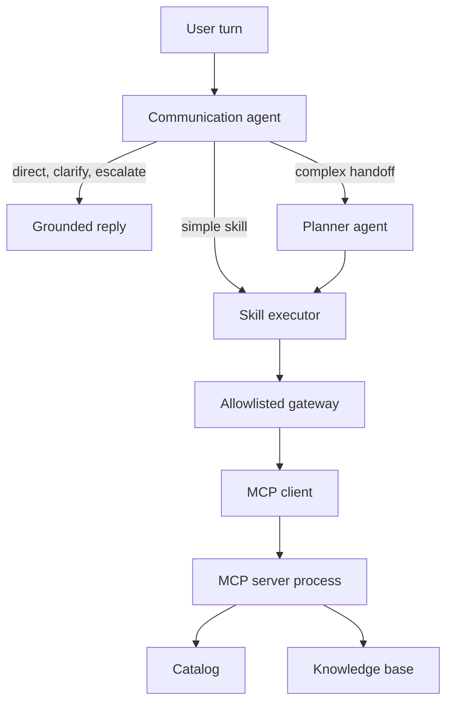

# Architecture

The lab has four replaceable layers and one orchestrator.

1. **Catalog** and **knowledge base** load a snapshot. They answer structured queries. They do not place orders or open a network connection.
2. **MCP server** exposes those queries as an allowlisted tool and resource set. The server process speaks framed JSON-RPC on stdio.
3. **Skills** are versioned workflows. A skill may call only the tools in its contract. The constraint check skill is pure and calls no tool.
4. **CA and PA** decide what to ask for. The session runner executes those decisions against a sandbox. It does not read gold replies.

Session context is a profile, a seven-day recent memory, and the current session. The session input is the latest 10 messages, a summary through a watermark, and structured state. See `docs/memory.md`. `active_task_id` is set only while a planner task is running and is cleared before the turn is stored. The planner's observation list is not the session memory.

A simple thanks, greeting, acknowledgement, or unrelated message is a direct answer. A policy or single-item price question uses one skill. Search, recommendation, comparison, stock recovery, and multi-step faults go to the planner.

Extension points, without editing the turn loop:

- A new catalog or knowledge file is a path argument.
- A new skill is `registry.register`.
- A new planner goal is `PlanRegistry.register`.
- A new tool is an entry on the server tool map; clients discover it.

See `docs/sandbox.md` for what this isolation does and does not promise.
